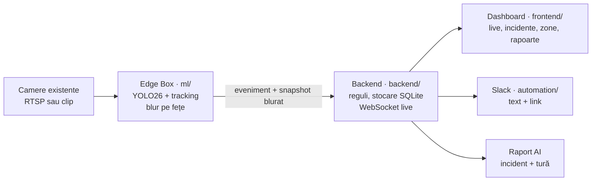

<div align="center">

# SafeSight

**Camerele care există deja pe platformă devin senzori de siguranță.**
O intrare în zona motorului pornește singură alerta, raportul și escaladarea — fără un operator care se uită la 40 de ecrane.


[Demo](#demo) · [Cum funcționează](#cum-funcționează) · [Pornire rapidă](#pornire-rapidă) · [Contract](docs/contract.md) · [Pornire detaliată](RUNNING.md)

</div>

## Ce face

Ce se vede în demo-ul oficial, pe trei camere redate din clipuri:

- **Zonă restricționată** — persoana intră în zona motorului cât timp motorul e pornit: `RESTRICTED_ZONE`, `CRITICAL`, cu poligonul desenat pe imagine, care urmărește solul când camera se mișcă.
- **Live adnotat** — detecție, tracking între cadre și etichetă de vestă pe fiecare persoană (`vesta`, `FARA VESTA`, `vesta ?`), pe trei camere în paralel.
- **Incident cu dovadă** — snapshot blurat, severitate, cronologie și raport de incident scris (LLM, cu șablon ca rezervă).
- **Alertă și escaladare** — Slack primește text + link; dacă nimeni nu confirmă, incidentul urcă la supervisor; confirmarea oprește escaladarea.
- **Raport de tură** — KPI, distribuție pe tipuri, rezumat.

## Cum funcționează



1. **Edge-ul** citește camera, detectează persoanele, le urmărește între cadre și aplică regulile zonei. Confirmă un eveniment doar după o fereastră temporală, ca un cadru ratat să nu sune.
2. **Blur-ul** rulează înainte de orice scriere: fețele și capetele sunt acoperite pe cadrul live, pe snapshot și pe clipul adnotat. Video-ul nu iese din aeroport.
3. **Backend-ul** validează evenimentul după contract, îl stochează, îl trimite pe WebSocket și programează escaladarea.
4. **Automatizarea** scrie raportul — textul recomandat vine din tabelul fix pe tip, LLM-ul doar îl reformulează, iar fără LLM se folosește șablonul — și trimite alerta.

## Demo

Aplicația în funcțiune, în două clipuri scurte. În README se joacă o secvență din fiecare; fișierele complete sunt în [folderul SafeSight de pe Google Drive](https://drive.google.com/drive/folders/1OTXiPjvX7PCAGDeXVKPa702PyQQZgzhA?usp=sharing), pentru că `.mp4` nu intră în git.

| `DemoSafeSight.mp4` · 0:38 | `Demo_Max.mp4` · 1:34 |
|---|---|
| [](https://drive.google.com/file/d/1EgnWY80N8CDgNlwvrp3tbbkmiXWpPlEi/view) | [](https://drive.google.com/file/d/1IsnC-LNpnaLKBT8i92MNsUoe0vYuK8Xk/view) |
| Platforma reală: avion la poartă, muncitori cu veste, apoi aplicația — zonele desenate pe imagine, incidentele în listă, detaliul incidentului și editorul de zone. | Live Monitor filmat continuu cu webcam-ul (fața blurată): etichetele de vestă pe fiecare cadru și incidentele care apar, se confirmă și escaladează în lista din dreapta. |

Secvențele din README sunt tăiate (10 s, fără sunet, 640 px) ca să se încarce repede; clipul întreg, cu sunet, e pe Drive.

## Pornire rapidă

Pe Linux, macOS sau Windows, cu Python 3.12+:

```bash
python scripts/dev.py setup   # o singură dată: dependențe backend, ML, frontend și modelul de blur
python scripts/dev.py demo    # backend + dashboard + câte un edge pe fiecare cameră
```

Echivalent: `./run.sh demo` pe Linux/macOS, `run.cmd demo` pe Windows. Verificare de mediu: `python scripts/dev.py doctor`.

| Ce pornește | Unde | Ce vezi |
|---|---|---|
| Dashboard | <http://localhost:5173> | live pe 3 camere, incidente, zone, rapoarte |
| API | <http://localhost:8000> | `/health`, `/events`, `/stream/{camera}.mjpg`, `/ws/events` |
| Edge-uri | 3 procese | `stand12`, `taxiway-b`, `baggage-area`, fiecare pe clipul lui, în buclă |

`.env` e opțional pentru demo. Fără `SLACK_WEBHOOK_URL` alerta rămâne în aplicație și se consemnează ca simulată; cu webhook, pleacă text + link.

## Parcursul demo, în 90 de secunde

1. **Live, CAM-01** — persoana intră în zona motorului → `RESTRICTED_ZONE` `CRITICAL`, cu snapshot blurat.
2. **Feed adnotat** — zonă, track pe fiecare persoană, etichetă de vestă; zona rămâne pe asfalt când camera se mișcă.
3. **CAM-03, apoi CAM-02** — aceeași procesare în paralel, pe fiecare cameră.
4. **Detaliul incidentului** — snapshot, cronologie, raport scris.
5. **Confirmă** — escaladarea se oprește.
6. **Slack** — text + link, fără imagini și fără butoane.
7. **Rapoarte Tură** — KPI pe tură, distribuție, rezumat.
8. **Edge & Audit, apoi privacy** — detecția, tracking-ul, blur-ul și decizia rulează la margine; backend-ul primește evenimentul, nu video.

Scenariul complet, cu ce spui la fiecare pas: [`demo/run_sheet.md`](demo/run_sheet.md). Dacă un edge cade, `python scripts/dev.py fallback` trimite pe aceleași rute un eveniment de rezervă.

## Module

| Folder | Ce conține | Responsabil |
|---|---|---|
| [`ml/`](ml/README.md) | Detecție (YOLO26), tracking, zone, FOD, blur pe fețe | Andrei |
| [`backend/`](backend/README.md) | FastAPI, rule engine, WebSocket, stream video, stocare | Max |
| [`automation/`](automation/README.md) | Raport AI, notificări Slack, escaladare, raport de tură | Dalina |
| [`frontend/`](frontend/README.md) | Dashboard React + Vite | Ariana |
| [`demo/`](demo/README.md) | Scenariul demo și înregistrarea de rezervă | Ariana + Dalina |
| [`docs/`](docs/contract.md) | Contractul API și documentele comune | toți |

Fiecare folder are propriul `README.md` cu pornirea și comanda lui de verificare.

## Contract și documente

- [`docs/contract.md`](docs/contract.md) — contractul canonic dintre module; se schimbă doar prin pull request aprobat de cel afectat.
- [`RUNNING.md`](RUNNING.md) — cerințe, setup, variante de pornire, probleme frecvente.
- [`docs/performance.md`](docs/performance.md) — ce s-a măsurat și ce s-a închis, cu cifre.
- Briefingurile interne de rol A–D (Typst + PDF) sunt în repo-ul privat `DaVecTORzzz/safesight-docs`. Sunt explicative; dacă diferă de contract, contractul câștigă.

## Ce e real, ce e fallback

| | |
|---|---|
| **Real** | YOLO26 + ByteTrack, zonele care urmăresc camera, eticheta de vestă după culoare, blur pe fețe înainte de scriere, ingestie idempotentă, WebSocket live, escaladare anulată de confirmare, stocare SQLite, raportul |
| **Fallback** | Fără LLM → raportul folosește șablonul (`source=template`); fără webhook → alerta e marcată simulată în log; fără MJPEG → snapshot la 500 ms; `dev.py fallback` → incident trimis manual pe aceleași rute; `USE_MOCK=true` → evenimente false pentru frontend |
| **Stock / simulat** | Clipurile — filmate din mână, redate în buclă ca trei camere; operatorul; Slack fără webhook; raportul fără cheie LLM; zona desenată urmărește o cameră care se mișcă |

## Date care nu intră în git

Video-urile de test (`.mp4`), modelele antrenate (`.pt`, `.onnx`) și baza de date locală sunt ignorate de git. Le țineți în folderul comun din Google Drive, [SafeSight](https://drive.google.com/drive/folders/1OTXiPjvX7PCAGDeXVKPa702PyQQZgzhA?usp=sharing). README-urile din `data/videos/` și `data/annotations/` rămân versionate, ca să știm sursa și licența fiecărui clip.

## Reguli de lucru

- `main` trebuie să ruleze mereu. Lucrați pe branch-uri scurte (`max/rule-engine`, `ariana/live-monitor`) și intrați în `main` prin pull request.
- Commit-uri cu prefix: `ml:`, `api:`, `ui:`, `auto:`, `docs:`.
- Asistenții AI citesc regulile din [`AGENTS.md`](AGENTS.md); `CLAUDE.md` trimite tot acolo.
- Înainte de lucru: `./scripts/agent-preflight.sh` sincronizează repo-ul public și repo-ul privat de documente.
