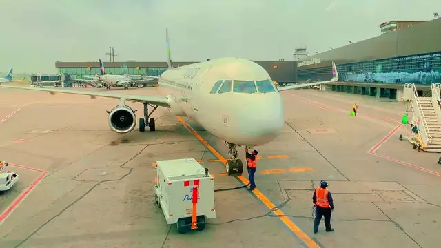
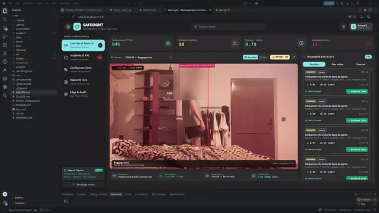

# SafeSight

Inspector automat de siguranță pentru platforma aeroportului. Camerele existente sunt analizate local, pe un Edge Box: echipament de protecție lipsă, persoane în zone restricționate, obiecte pe pistă (FOD), fumat (stretch). Fiecare încălcare pornește singură fluxul de răspuns: alertă cu link la incident, raport de incident scris de AI și escaladare dacă nimeni nu confirmă. Snapshot-ul blurat se vede în aplicație, nu în Slack.

Video-ul nu iese din aeroport. Fețele sunt blurate înainte de orice salvare.

## Demo

Aplicația în funcțiune, în două clipuri scurte. În README se joacă o secvență din fiecare (10 s, fără sunet, 640 px); fișierele complete sunt în [folderul SafeSight de pe Google Drive](https://drive.google.com/drive/folders/1OTXiPjvX7PCAGDeXVKPa702PyQQZgzhA?usp=sharing), pentru că `.mp4` nu intră în git.

| `DemoSafeSight.mp4` · 0:38 | `Demo_Max.mp4` · 1:34 |
|---|---|
| [](https://drive.google.com/file/d/1EgnWY80N8CDgNlwvrp3tbbkmiXWpPlEi/view) | [](https://drive.google.com/file/d/1IsnC-LNpnaLKBT8i92MNsUoe0vYuK8Xk/view) |
| Platforma reală: avion la poartă, muncitori cu veste, apoi aplicația — zonele desenate pe imagine, incidentele în listă, detaliul incidentului și editorul de zone. | Live Monitor filmat continuu cu webcam-ul (fața blurată): detecțiile cadru cu cadru și incidentele care apar, se confirmă și escaladează în lista din dreapta. |

Ce e real: detecția rulează pe clipurile din `data/videos/` sau pe camera locală, nu pe o animație. Ce nu e: secvențele din README sunt tăiate și fără sunet, ca să se încarce repede.

## Structura

| Folder | Ce conține | Responsabil |
|---|---|---|
| `ml/` | Detecție (YOLO26), tracking, zone, FOD, blur pe fețe | Andrei |
| `backend/` | FastAPI, rule engine, WebSocket, stream video, stocare | Max |
| `automation/` | Raport AI, notificări Slack, escaladare, raport de tură | Dalina |
| `frontend/` | Dashboard React + Vite | Ariana |
| `demo/` | Scenariul demo și instrucțiunile pentru înregistrarea de rezervă | Ariana + Dalina |
| `docs/` | Contractul API și alte documente comune | toți |

## Documente

- [`docs/contract.md`](docs/contract.md) — contractul canonic dintre module; se schimbă doar prin pull request aprobat de cel afectat.
- Briefingurile interne de rol A–D (Typst + PDF) sunt în repo-ul privat `DaVecTORzzz/safesight-docs`. Sunt explicative; dacă diferă de contract, contractul câștigă.

## Pornire

Pe Linux, macOS sau Windows, cu Python 3.12+:

```bash
python scripts/dev.py setup   # o singură dată
python scripts/dev.py demo    # backend + frontend + un run real pe clip
```

sau `./run.sh demo` / `run.cmd demo`. Detalii, cerințe și variante: [`RUNNING.md`](RUNNING.md).

0. `./scripts/agent-preflight.sh` — sincronizează repo-ul public și repo-ul privat de documente înainte de lucru.
1. `cp .env.example .env` și completează cheile; `.env` e opțional pentru demo.
2. Fiecare modul are în folderul lui un `README.md` cu pornirea și comanda de verificare.
3. Cât timp un modul nu e gata, ceilalți lucrează cu `USE_MOCK=true` și cu fixture-urile din `frontend/fixtures/`.

## Date care nu intră în git

Video-urile de test (`.mp4`), modelele antrenate (`.pt`, `.onnx`) și baza de date locală sunt ignorate de git. Le țineți în folderul comun din Google Drive, [SafeSight](https://drive.google.com/drive/folders/1OTXiPjvX7PCAGDeXVKPa702PyQQZgzhA?usp=sharing). README-urile din `data/videos/` și `data/annotations/` rămân versionate, ca să știm sursa și licența fiecărui clip.

## Reguli de lucru

- `main` trebuie să ruleze mereu. Lucrați pe branch-uri scurte (`max/rule-engine`, `ariana/live-monitor`) și intrați în `main` prin pull request.
- Commit-uri cu prefix: `ml:`, `api:`, `ui:`, `auto:`, `docs:`.
- Asistenții AI (Claude Code etc.) citesc regulile din [`CLAUDE.md`](CLAUDE.md).
